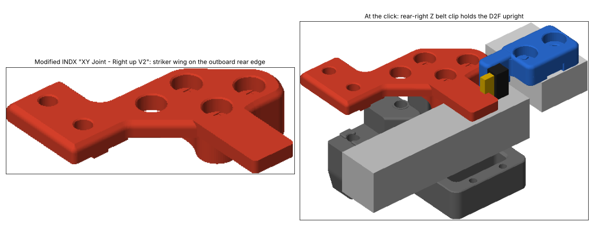
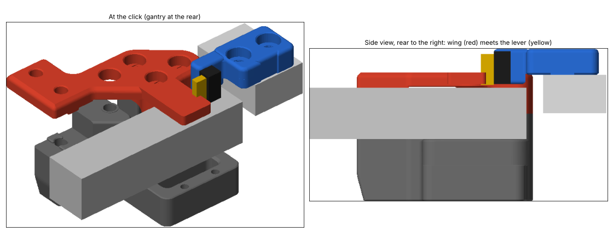
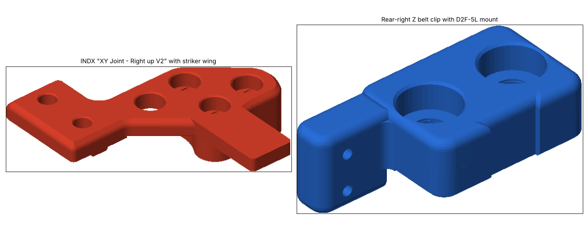
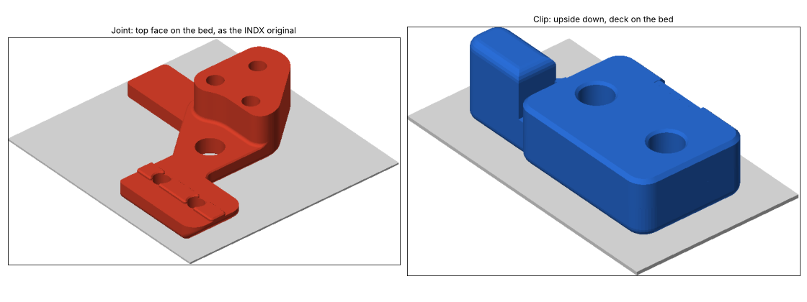

# INDX Voron 2.4 rear Y endstop

A rear Y endstop for a **Voron 2.4** running the **[INDX for Voron 2.4](https://github.com/karasgit/INDX-for-Voron-2.4)** rear-mount tool changer with an **umbilical** (no cable chains). Print two replacement parts and the endstop is built in: no add-on brackets, no extra screws, and nothing on the toolhead side of the gantry.



- **Joint** — INDX `XY Joint - Right up V2` with a striker wing on its outboard rear edge.
- **Clip** — the rear-right Voron Z belt clip (upper) with a cheek that holds an Omron D2F-5L microswitch upright, lever tip down.

When the gantry moves to the rear, the wing on the joint presses the switch lever. The switch triggers at the same Y travel as the stock Voron Y endstop, so you keep stock Y travel.

---

## Contents

- [Why this exists](#why-this-exists)
- [Compatibility](#compatibility)
- [Parts and hardware](#parts-and-hardware)
- [Printing](#printing)
- [Installation](#installation)
- [Klipper configuration](#klipper-configuration)
- [First homing checklist](#first-homing-checklist)
- [Design notes](#design-notes)
- [Adjusting and regenerating](#adjusting-and-regenerating)
- [Repository layout](#repository-layout)
- [Credits and license](#credits-and-license)

---

## Why this exists

INDX moves the toolhead to the **rear** of the X extrusion and docks tools at the back of the printer. INDX's own Y endstop sits on the front-right Z bearing block. If that position is taken (by another mod, for example), you need a rear endstop, and the usual options don't fit INDX:

- **Stock Voron Y endstop pod**: it lives under the XY joint and needs the Y cable chain for its wiring. With an umbilical, the Y chain is gone.
- **[Y endstop relocation mod](https://www.printables.com/model/324787-voron-v24-and-trident-y-endstop-relocation-mod)**: the switch sits on the front motor screws, centred on the motor, and a bumper bolts to the stock XY joint's cable-bridge holes. On INDX:
  - the X bar is reversed, so the joint's tab screws are at the front, 51.3 mm further forward than on the stock joint;
  - the inboard rear corner of the joint is trimmed so the carriage, with its X endstop, can reach the joint at X max.

  A bumper that reaches the relocated switch would stick 10–15 mm into the toolhead's path.

This design moves everything to the **outboard** rear corner, in front of the Z belt clip, into the space the Y cable chain used to occupy. The toolhead can never reach it, at any X.



## Compatibility

| | |
| --- | --- |
| Printer | Voron 2.4 (r2 geometry). The gantry corner is the same for 250/300/350, so the trigger point doesn't depend on size. Developed on an LDO Voron 2.4 Rev D 350. |
| Tool changer | INDX for Voron 2.4, with `XY Joint - Right up V2` |
| Cabling | Umbilical, **no Y cable chain**. The wing runs where the chain used to lie. |
| Switch | Omron D2F-5L (hinge lever), same as the stock Voron endstops |
| Side | Right side only (right XY joint, right-rear Z belt clip). A left version would mirror, but isn't verified against the INDX left joint. |

## Parts and hardware



| File | Replaces | Qty |
| --- | --- | --- |
| [`stl/INDX XY Joint - Right up V2 - Y endstop.stl`](stl/) | INDX `XY Joint - Right up V2` | 1 |
| [`stl/z_belt_clip_upper_rear_right_y_endstop.stl`](stl/) | The Z belt clip (upper) on the **right-rear** drive only. The other three corners keep the stock clip. | 1 |

**Hardware**

| Item | Qty | Notes |
| --- | --- | --- |
| Omron D2F-5L microswitch | 1 | Hinge lever |
| M2x10 self-tapping screw | 2 | Fixes the switch to the cheek, from the outboard side |
| Wire + connector to your MCU | – | Same as a stock Voron endstop |

Everything else is reused: the joint's M5x10 tab screws and bearing screws, and the clip's **stock M5x16** screws. The clip is counterbored to the stock head seat.

## Printing



| Part | Orientation | Supports |
| --- | --- | --- |
| Joint | As exported, which is the INDX original orientation: top face on the bed | None |
| Clip | As exported: upside down, deck on the bed, cheek pointing up | None |

Use Voron print settings: ABS/ASA, 0.2 mm layers, 4 perimeters, 5 top/bottom layers, 40 % infill.

**About the STL structure.** Each STL contains the **original** INDX or Voron mesh, untouched, plus the new features as separate closed bodies that overlap it. Every body is watertight: 0 open edges, 0 non-manifold edges, 0 degenerate facets. PrusaSlicer, OrcaSlicer, Bambu Studio, SuperSlicer and Cura merge overlapping bodies into one solid when slicing; no repair is needed. If you'd rather have a single fused mesh, render the OpenSCAD source (see [Adjusting and regenerating](#adjusting-and-regenerating)).

## Installation

1. **Clear the extrusion top.** Remove anything left on top of the right gantry extrusion near the rear: old Y chain anchors, T-nuts, screw heads. The wing passes **1.4 mm** above it.
2. **Joint.** Swap the INDX `XY Joint - Right up V2` for the new one, as in any INDX rebuild. The bearing stack, bearing screws and the two M5x10 tab screws into the X extrusion are unchanged.
3. **Switch.** Fix the D2F-5L to the outboard face of the clip's cheek with two M2x10 self-tapping screws, inserted from the outboard side:
   - the body sits flush with the cheek's front edge;
   - the lever faces forward with its **tip at the bottom**;
   - the terminals point backwards.

   Solder the wires to the two outer pins, the same way as your stock Voron endstops, and route them up and back.
4. **Clip.** Support the gantry, then swap the right-rear Z belt clip. Fit one screw before removing the other clamp from the belt, so the belt end never slips. The Z belt runs up the vertical slot on the outboard side, as with the stock clip. Use the **stock M5x16** screws.
5. **QGL.** Run a quad gantry level afterwards, since the clip held the Z belt.

## Klipper configuration

Your INDX setup currently homes Y at the **front**. The goal is to home at the rear without changing your coordinate system, so the dock positions in your INDX config stay valid.

**1. Find the trigger coordinate with your current setup.** Home as usual (front Y endstop). Move to the X where you'll home Y, then step Y backwards slowly while you check the new switch:

```
G28
G1 X<homing_x> F6000
G1 Y<a safe value, e.g. 300> F3000
QUERY_ENDSTOPS        ; add the new switch temporarily, e.g. as a [gcode_button] or a spare endstop pin
G91
G1 Y1 F300            ; repeat in 1 mm, then 0.1 mm steps until the switch reads "TRIGGERED"
G90
M114                  ; note the Y position: this is your trigger coordinate
```

All docking moves must stay **below** this Y coordinate.

**2. Point Y at the new switch.**

```ini
[stepper_y]
endstop_pin: ^<your MCU pin>     # e.g. the old Y endstop input; add ! if QUERY_ENDSTOPS reads inverted
position_endstop: <trigger Y>     # value from step 1
position_max: <trigger Y>         # same value: never drive past the switch
homing_positive_dir: true
homing_speed: 20                  # slow for the first homes; raise later
second_homing_speed: 5
homing_retract_dist: 5
```

**3. Home Y at a safe X.** The tool rack is at the rear, so Y must home at an X where the toolhead's path backwards is clear of the docks and the drive. If you use a `[homing_override]` or `[safe_z_home]`, home **X first**, move to that X, then home Y. Keep the INDX tool-changer macros in charge of tool state, as before.

## First homing checklist

- [ ] Motors off: push the gantry back by hand at your homing X. The switch **clicks before anything else touches**, including the toolhead and the dock.
- [ ] `QUERY_ENDSTOPS` shows `open` with the gantry away from the switch and `TRIGGERED` with the lever pressed.
- [ ] `homing_speed` is low (20 mm/s) for the first homes, and your hand is near the power switch.
- [ ] After homing, a dock/undock cycle at each tool position works without the switch triggering.
- [ ] `G28 Y` repeated 10 times gives consistent positions (check with `M114` or a probe at a fixed point).

## Design notes

All geometry was measured from the official **Voron 2.4 r2 CAD assembly** (STEP), the **INDX STLs**, and the Omron **D2F-5L** model in the Voron CAD. The numbers below use the Voron CAD frame: X to the right, Y to the rear, Z up, with travel measured from the CAD gantry pose.

**Trigger point**

| Event | Gantry travel from CAD pose |
| --- | --- |
| Wing touches the lever tip | 124.5 mm |
| Switch triggers (D2F operating point, ±1.2 mm) | **≈ 126.5 mm** (stock Y endstop pod: ≈ 126–127 mm) |
| Wing meets the switch body / cheek face | 129.5 mm |
| INDX joint reaches the Z bearing block (hard limit, same as stock) | 129.85 mm |

That leaves about 3 mm between the click and the first contact.

**Clearances**

| Item | Clearance |
| --- | --- |
| Wing ↔ right gantry extrusion top (Z 88.0) | 1.4 mm |
| Wing ↔ A/B belts (Z ≤ 86) | ≥ 3.4 mm |
| Cheek ↔ drive frame front face | 0.3 mm (in front of it) |
| Cheek ↔ joint plate edge (lateral, at the stop) | 2.8 mm |
| Cheek / switch ↔ Z belt | in front of the clip face; the belt runs behind it |
| Clip deck ↔ cable cover | 4.5 mm |
| Wing at Y min ↔ front idler / front Z belt clip | 6.6 mm more margin than the joint's own limit |
| Anything ↔ toolhead | nothing extends inboard of the joint |

**Joint**

The wing is 4.5 mm thick and level with the top face of the top plate, so the part prints exactly like the original INDX part. Its rear edge is the striker. It reaches from the plate's outboard edge to X 331.5, outboard of the joint, above the right gantry extrusion.

**Clip**

- **Underside:** keeps the stock clip's belt-gripping underside.
- **Deck:** a 5.6 mm deck follows the **original clip contour**, so its walls continue the clip's walls. Its edges are rounded 1.5 mm.
- **Belt slot:** the vertical belt slot on the outboard side is a uniform 9.2 × 1.0 mm channel from the drive top to the top of the deck. The stock groove's deeper lead-in and lead-out are filled.
- **Counterbores:** Ø10 mm, with a flat seat at the stock head height, so the stock M5x16 screws fit.
- **Cheek:** stands in front of the clip and has rounded edges. The D2F's 6.5 mm hole pair lines up vertically with its lower end at Z 89.3, so the lever tip points down into the wing's band.

**Verification**

- **Meshes:** each body was checked watertight. Every hole (both clip screws, both M2 pilots, all six joint holes) was probed open along its axis.
- **Screw heads:** the Ø9.5 head space above both clip screws was probed clear.
- **Clearances:** checked against the CAD assembly at the click and at the stop.

## Adjusting and regenerating

[`cad/indx_rear_y_endstop.scad`](cad/indx_rear_y_endstop.scad) imports the original meshes from `cad/source_stl/` and adds the new features. Set `part` to `"joint"`, `"clip"` or `"assembly"` (both parts at the moment of the click). Rendering it in OpenSCAD gives a single fused mesh; the round-overs use `minkowski`, so their profile differs very slightly from the STLs.

| Parameter | Default | Effect |
| --- | --- | --- |
| `striker_face_y` | 171.8 | Y of the wing's striker face at the CAD pose. **+1 = trigger 1 mm later** (further back). Keep at least 2 mm between the click and the stop. |
| `wing_bottom` | 89.4 | Underside of the wing; the extrusion top is 88.0 |
| `wing_x_end` | 331.5 | Outboard end of the wing |
| `switch_hole_y` | 306.3 | D2F hole line; moves the switch forward or back |
| `switch_bottom` | 89.3 | Lower end of the switch body (lever tip end) |
| `deck_top` | 103.0 | Top of the clip deck |

If the trigger point needs moving, changing `striker_face_y` and reprinting only the joint is usually enough.

## Repository layout

```
stl/
  INDX XY Joint - Right up V2 - Y endstop.stl      # print this (joint)
  z_belt_clip_upper_rear_right_y_endstop.stl       # print this (rear-right Z belt clip)
cad/
  indx_rear_y_endstop.scad                         # editable source
  source_stl/                                      # original meshes imported by the .scad
    INDX XY Joint - Right up V2.stl                #   from INDX for Voron 2.4 (GPLv3)
    voron_z_belt_clip_upper.stl                    #   from Voron 2.4 (GPLv3)
images/                                            # renders used in this README
LICENSE                                            # GPLv3
```

## Credits and license

- **[INDX for Voron 2.4](https://github.com/karasgit/INDX-for-Voron-2.4)** by karasgit: the `XY Joint - Right up V2` this joint is derived from (GPLv3).
- **[Voron Design — Voron 2.4](https://github.com/VoronDesign/Voron-2)**: the Z belt clip this clip is derived from, and the CAD assembly used for every measurement (GPLv3).
- **[Voron V2.4 and Trident Y endstop relocation mod](https://www.printables.com/model/324787-voron-v24-and-trident-y-endstop-relocation-mod)** on Printables: the idea of moving the Y endstop to the rear and using a D2F with a bumper.

Released under the **GNU General Public License v3.0**; see [LICENSE](LICENSE). The derived parts stay GPLv3, as their sources require.
